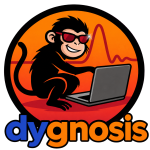

Dygnosis adds Dynare language support to VS Code and AI coding agents. Edit and analyze models without a separate Dynare, MATLAB or Octave installation.

Install the extension in VS Code 1.102.0 or later from the [VS Code Marketplace](https://marketplace.visualstudio.com/items?itemName=CoconutWater.dygnosis). Extension packages and standalone LSP and MCP bundles are also available from [GitHub Releases](https://github.com/naivej/dygnosis/releases). In VS Code, press `F1` and run **Dygnosis: Open Help**, or find **Dygnosis** in **Extensions** and choose **Open Help** from its gear or context menu.

## Highlights

- **Catch source problems early.** Check for Dynare source errors and likely modeling mistakes as you edit, with guidance to investigate and fix issues.
- **Follow models across files.** Navigate declarations, equations and their uses across a model and its included files in the context of the selected parent model.
- **Explore model configurations.** Preview macro expansion and see how different macro inputs, branches and equation selections affect your analysis without changing the source.
- **Read models at a glance.** Understand model structure, symbol roles and parameter values while reading your code.
- **Write and refactor faster.** Get suggestions in model context and update related declarations and equations together.
- **Review model changes.** See how equations and model setup differ between files, revisions or analysis configurations.
- **Audit workspace models.** See which saved models across your workspace need attention in Explorer's **Dynare Workspace** view.

AI coding agents can use Dygnosis's [MCP tools](https://github.com/naivej/dygnosis/blob/main/help/agents.md). Install the [`use-dynare` agent skill](https://github.com/naivej/dygnosis/blob/main/.agents/skills/use-dynare/SKILL.md) with `npx skills add naivej/dygnosis`.

## Running Models

Run official Dynare in MATLAB or Octave to compute steady states, verify Blanchard-Kahn conditions, and execute simulations or estimation. For MATLAB integration in VS Code, see the [MATLAB extension for VS Code](https://github.com/mathworks/MATLAB-extension-for-vscode) and [MATLAB agentic toolkit](https://github.com/matlab/matlab-agentic-toolkit).

**Compatibility**: Dynare 7.2

## Credits

1. Dygnosis started as a fork and full rewrite of [LLMacro-Dynare-LSP](https://github.com/pdwhoward/LLMacro-Dynare-LSP) by Anthony Diercks, Philip Howard and Mehrdad Samadi (*LLMacro: A Language Server for Dynare — Structured Context for AI-Assisted Macroeconomic Modeling*).
2. Equation, tag and extraction features are informed by the Dynare Team's [modBuilder](https://git.dynare.org/Dynare/modBuilder).
3. The bundled agent skill is adapted from [EconSolider/dynare-copilot](https://github.com/EconSolider/dynare-copilot).

## License

Dygnosis is licensed under [GPL-3.0-or-later](https://github.com/naivej/dygnosis/blob/main/LICENSE). The `use-dynare` skill is licensed under [MIT](https://github.com/naivej/dygnosis/blob/main/.agents/skills/use-dynare/LICENSE).
