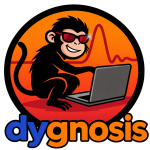

 

Dygnosis adds Dynare language support to VS Code. Install it from the [VS Code Marketplace](https://marketplace.visualstudio.com/items?itemName=CoconutWater.dygnosis) to start editing models.

- Edit with live diagnostics, hover, completion, document or selection formatting, fixes, and commented shock templates.
- Follow names with **Go to Definition**, **Find All References** and **Rename symbol** across known includes. Browse **Outline**, fold blocks and open linked model files.
- Inspect model counts, equations, includes, and expanded source, with jumps back to the written equations.
- Compare a model with Git history or another `.mod` file.
- An overview of all dynare models in the current workspace.
- Run **Dygnosis: Open Help** to learn more.

It also provides [MCP tools](https://github.com/naivej/dygnosis/blob/main/help/agents.md) and a [use-dynare skill](https://github.com/naivej/dygnosis/blob/main/.agents/skills/use-dynare/SKILL.md) for agents.

Editing and source analysis work without a Dynare installation. Run official Dynare in MATLAB or Octave for steady states, stability checks and model solutions. For MATLAB integration, see the [MATLAB extension for VS Code](https://github.com/mathworks/MATLAB-extension-for-vscode) and [MATLAB agentic toolkit](https://github.com/matlab/matlab-agentic-toolkit).

**Compatibility**: Dynare 7.2

## Credits

1. Dygnosis v0.1.0 is a fork and rewrite of [LLMacro-Dynare-LSP](https://github.com/pdwhoward/LLMacro-Dynare-LSP) by Anthony Diercks, Philip Howard and Mehrdad Samadi. That repository accompanies the working paper *LLMacro: A Language Server for Dynare — Structured Context for AI-Assisted Macroeconomic Modeling*.
2. Equation, tag and extraction ideas are informed by the Dynare Team's [modBuilder](https://git.dynare.org/Dynare/modBuilder).
3. The bundled agent skill is adapted from [EconSolider/dynare-copilot](https://github.com/EconSolider/dynare-copilot).

## License

Dygnosis is licensed under [GPL-3.0-or-later](https://github.com/naivej/dygnosis/blob/main/LICENSE). The use-dynare skill is licensed under [MIT](https://github.com/naivej/dygnosis/blob/main/.agents/skills/use-dynare/LICENSE).
